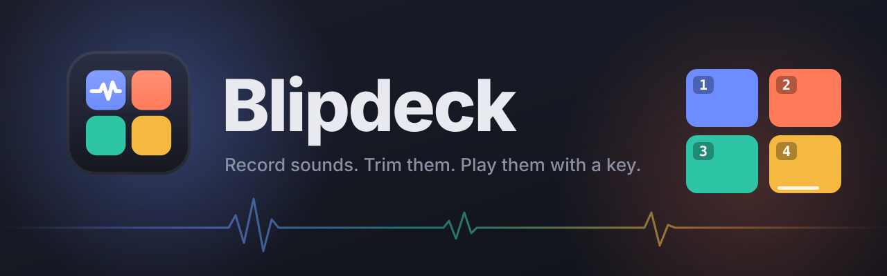

<p align="center">
  
</p>

<p align="center">
  <a href="https://github.com/azammarchi/blipdeck/actions/workflows/ci.yml"></a>
  <a href="LICENSE"></a>
</p>

<p align="center">
  <a href="https://azammarchi.github.io/blipdeck/"><strong>▶ Try the live demo</strong></a>
</p>

**Blipdeck** is a soundboard that runs entirely in your browser. Record sounds from your microphone (or import audio files), trim them, and play them by clicking a pad or pressing a keyboard shortcut. No accounts, no uploads: your sounds never leave your computer.

## Features

- 🎙️ **Record** from the microphone; silence at the start and end is removed automatically
- ✂️ **Trim** any sound on its waveform, with preview and one-click silence removal
- ⌨️ **Keyboard shortcuts**: bind any key to any pad
- 🔁 **Loop** and **rename** any pad
- ↕️ **Reorder** pads by dragging them
- 💾 **Export / import** your whole board (sounds, names, keys) as a single file
- 🌐 **12 languages**: English, Italiano, Español, Français, Deutsch, Português, Русский, 中文, 日本語, 한국어, हिन्दी, العربية
- 📦 **Zero dependencies**: plain HTML, CSS and JavaScript

## Try it online

The [live demo](https://azammarchi.github.io/blipdeck/) opens with eight sample pads on keys `1`–`8` (all synthesized in code). Everything works there too, recording included. Your changes are saved in your browser only, so every visitor gets their own copy of the demo; **Reset demo** in the top bar brings back the original sample pads.

## Run it locally

You only need [Node.js](https://nodejs.org) (no packages to install):

```bash
npm start
```

Your default browser opens at <http://localhost:5173>. If that port is busy, the next free one is used.

When you close the app's tab (or window) the server stops by itself. Reloading the page doesn't stop it, and with several tabs open it stops when the last one closes.

| Environment variable | Effect |
| --- | --- |
| `PORT=8080` | Use a different port |
| `NO_OPEN=1` | Don't open the browser |
| `KEEP_RUNNING=1` | Keep the server running after the last tab closes |

> The microphone only works on `localhost` or HTTPS, so serve the app with the included server rather than opening `index.html` as a file.

## How to use it

On the first launch you'll find a sample pad, **Ding**, on the `1` key. Delete it whenever you like; it won't come back.

| Action | How |
| --- | --- |
| Record a sound | **Record** button or the `R` key (press again to stop) |
| Import audio files | **Import**, then pick one or more audio files |
| Play | Click the pad or press its shortcut |
| Pad actions | The **⋯** button in the pad's corner opens its menu: shortcut, trim, rename, loop, delete |
| Assign a shortcut | **⋯ → Assign a keyboard shortcut**, then press the key you want (`Backspace` removes it, `Esc` cancels). Digits on the top row and on the numeric keypad count as the same key |
| Trim | **⋯ → Trim this sound**: drag the yellow handles, **Preview** to listen, **Remove silence** to cut it automatically, then **Save** |
| Reorder | Drag a pad where you want (a click without moving plays it) |
| Stop everything | **Stop all** or `Esc` |
| Change language | The flag menu in the top bar |

Trimming replaces the original audio (saved as WAV), so it can't be undone after saving.

## Backup and moving to another computer

- **Export** downloads a `blipdeck-YYYY-MM-DD.json` file with every sound, its name, key, color and loop setting.
- **Import** that file to load them back. If you already have sounds, you choose whether to **replace** them or **add** the imported ones; when adding, a key that's already taken stays with your existing sound.

## Where your sounds live

Sounds are stored in your browser (IndexedDB), so they're there when you come back, but they belong to that browser on that computer. They are never part of the repository: as an extra safety net, `.gitignore` also excludes exported `blipdeck-*.json` files and audio files saved in the project folder.

## Troubleshooting

If a keyboard shortcut doesn't respond, open the app with `?debug` at the end of the address (for example <http://localhost:5173/?debug>). A panel at the bottom shows every key press that reaches the page and what the app did with it.

## Tests

The end-to-end tests drive the real app with real mouse and keyboard input in **WebKit** (Safari's engine) and **Chromium**, using [Playwright](https://playwright.dev). They cover playback (including several pads at once), shortcuts, the pad menu, drag to reorder, trimming, recording, import/export, the online demo, migration from older versions and every language.

```bash
npm install
npm run test:install
npm test
```

`npm install` only adds the test tools: the app itself has no dependencies. The first command fetches Playwright, the second the two browsers it drives.

On GitHub, [CI](.github/workflows/ci.yml) runs the tests on every push and pull request, and the online demo is published only when they pass.

## Adding a language

All interface text lives in [`public/i18n.js`](public/i18n.js). Copy the `en` block, give it a new language code, a `name` and a small SVG `flag`, translate the strings, and it shows up in the language menu. Add `dir: 'rtl'` for right-to-left languages.

## License

[MIT](LICENSE)
